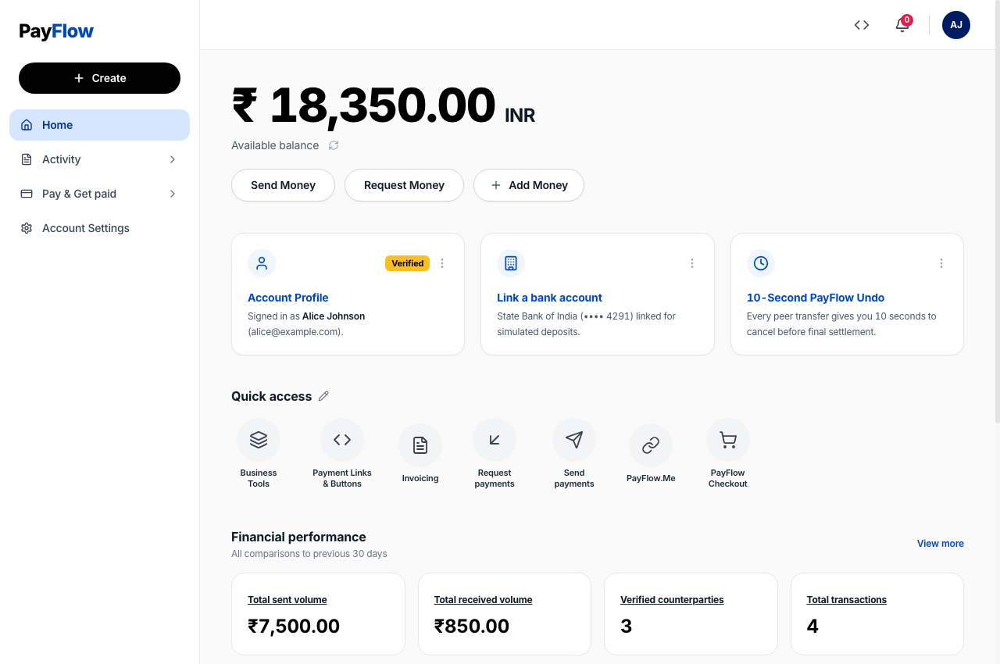
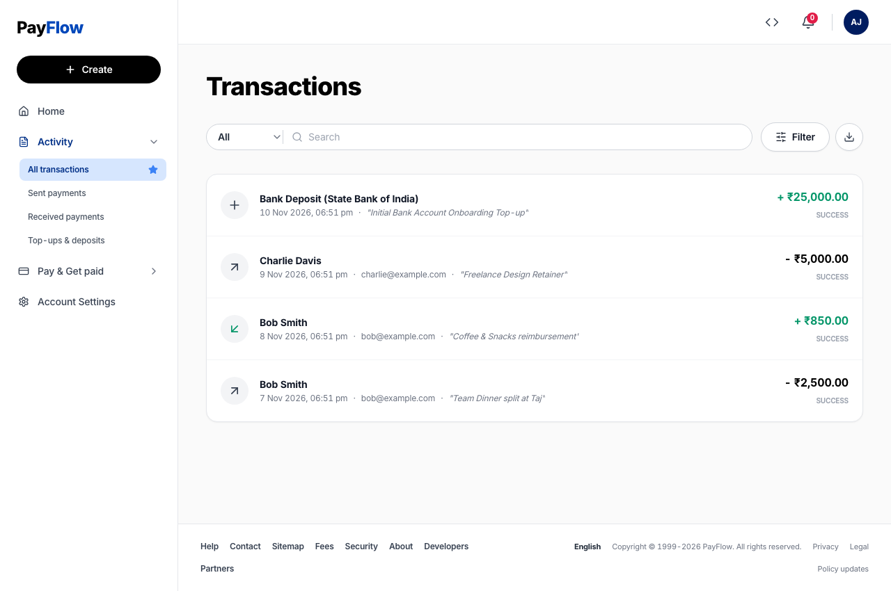
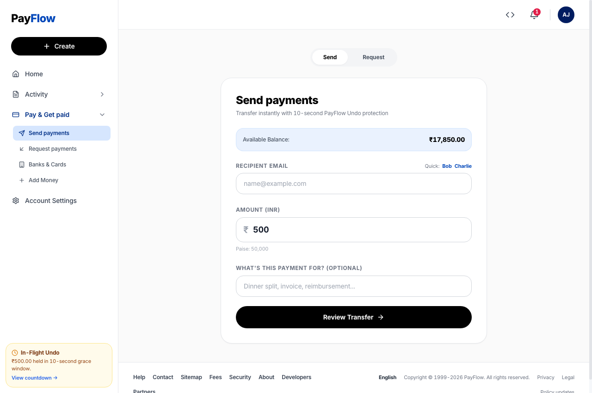
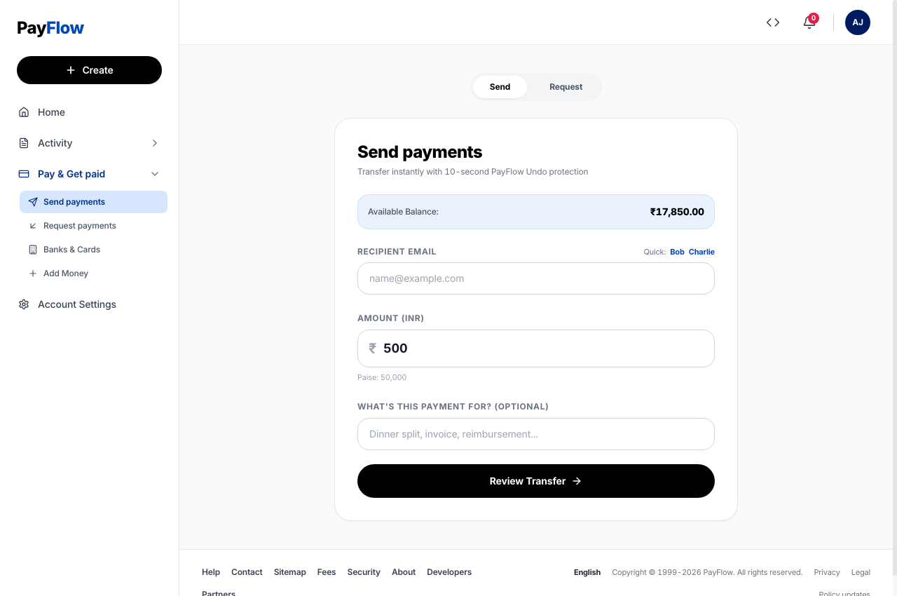

# PayFlow

> **Send Money Instantly. Never Lose a Cent.**

[](https://payflow-tan-phi.vercel.app)
[](https://payflow-backend-a8m4.onrender.com/api/health)
[](https://www.typescriptlang.org/)
[](https://www.mongodb.com/)

🔗 **Live Deployment:** [https://payflow-tan-phi.vercel.app](https://payflow-tan-phi.vercel.app)  
📡 **Live Backend API:** [https://payflow-backend-a8m4.onrender.com/api](https://payflow-backend-a8m4.onrender.com/api)

PayFlow is a high-integrity digital wallet and peer-to-peer (P2P) payment platform engineered with an authentic **PayPal-inspired web and mobile interface**. Built to demonstrate financial transaction correctness, strict concurrency control, double-spend prevention, and a signature **10-second payment undo window**.

---

## 📸 Product Walkthrough & Screenshots

### 1. Main Dashboard & Financial Overview
Clean, authentic PayPal layout featuring real-time available balance, quick action cards, quick-access circular shortcuts, and 30-day financial performance metrics.



---

### 2. Activity & Transaction History
Unified search and filter bar with type dropdown (`All`, `Sent`, `Received`, `Deposits`), live keyword search, filtered states, and one-click CSV statement export.



---

### 3. Signature Feature: 10-Second PayFlow Undo
Every outgoing peer transfer enters an atomic escrow state (`PENDING_UNDO`) for 10 seconds. The sender sees a real-time countdown progress bar and can cancel with one click to immediately refund funds to their available balance.



---

### 4. Verified Settlement & Digital Receipt
Once the 10-second grace window expires without cancellation, the background settlement engine automatically claims and finalizes the transaction, generating an immutable receipt with a copyable Transaction ID.



---

## ⚡ Core Features

* **⏱️ 10-Second PayFlow Undo:** Escrow grace period allowing instant recall of accidental transfers before ledger settlement.
* **🔒 Dual-Balance Fund Segregation:** Clear separation between `availableBalance` (spendable) and `heldBalance` (in-flight undo window) preserving the invariant:
  $$\text{Available Balance} + \text{Held Balance} = \text{Total Funds}$$
* **⚡ Concurrency & Double-Spend Defense:** Database lock-level atomic queries (`{ availableBalance: { $gte: amount } }`) preventing overdrafts even under 50 simultaneous transfer requests.
* **💰 Zero Floating-Point Drift:** All currency stored and computed in **integer paise** ($₹1.00 = 100\text{ paise}$), completely eliminating IEEE 754 precision rounding bugs.
* **🔁 API Idempotency:** Support for `Idempotency-Key` headers to prevent double-charging on flaky connections or repeated button clicks.
* **🏦 Simulated Bank Top-Ups:** Deposit funds from a linked State Bank of India account (`•••• 4291`) with zero transaction fees.
* **📱 100% Mobile & Tablet Responsive:** PayPal-style slide-out drawer on tablet and bottom tab bar on mobile (`Home`, `Activity`, `Send`, `Wallet`, `Profile`).

---

## 🛠️ Technology Stack

| Layer | Technologies |
| :--- | :--- |
| **Frontend** | React 18, TypeScript, Vite, Tailwind CSS, Lucide Icons, React Router |
| **Backend** | Node.js, Express, TypeScript, Zod, JWT, bcryptjs |
| **Database** | MongoDB 7 (Replica Set `rs0` for Multi-Document ACID Transactions), Mongoose |
| **Testing** | Vitest, Supertest, tsx |

---

## 🏛️ System Architecture

```
[ Client: React + TypeScript (Vite) ]
                  │
                  ▼  REST API (Bearer JWT & Idempotency-Key)
[ Express HTTP Router & Rate Limiter ]
                  │
                  ▼
[ Zod Validation & Authentication Middleware ]
                  │
                  ▼
[ Idempotency Deduplication Guard ]
                  │
                  ▼
[ Transfer & Wallet Domain Services ]
                  │
                  ▼
[ MongoDB Replica Set (Multi-Document ACID Transactions) ]
                  ▲
                  │  Polling & Finalizing (every 1s)
[ Background Settlement Worker ]
```

---

## 🚀 Quick Start (Local Setup)

### 1. Prerequisites
* **Node.js** v18+ and **npm**
* **MongoDB** v6+ running locally with a single-node replica set (`rs0`) on port `27017`

### 2. Installation
Clone the repository and install dependencies:
```bash
git clone https://github.com/Amit-Shukla07/payflow.git
cd payflow
npm install
```

### 3. Database Seeding
Seed demo users, wallets, and sample P2P transactions:
```bash
npm run seed
```

### 4. Run Development Servers
Start both backend and frontend concurrently:
```bash
npm run dev
```
* **Frontend:** `http://localhost:5173`
* **Backend API:** `http://localhost:5001/api`

---

## 🔑 Demo Accounts for Testing

| Email | Password | Initial Balance | Purpose |
| :--- | :--- | :--- | :--- |
| `alice@example.com` | `Password123` | ₹25,000.00 | Primary Sender / Receiver |
| `bob@example.com` | `Password123` | ₹15,000.00 | Secondary Recipient |
| `charlie@example.com` | `Password123` | ₹5,000.00 | Counterparty |

*(Tip: The login page includes 1-click quick-fill buttons for each demo account.)*

---

## 🧪 Automated Test Suite

PayFlow includes a comprehensive automated test suite covering authentication, wallet provisioning, transaction limits, idempotency deduplication, race conditions, and 10-second undo lifecycle:

```bash
# Run all backend unit & integration tests
npm run test:backend
```

**Results:**
```text
✓ tests/payflow.test.ts (15 tests)
  ✓ should register a new user and initialize a wallet
  ✓ should reject duplicate registration with same email
  ✓ [CONCURRENCY] 50 concurrent transfers of ₹100 from ₹1,000 balance result in exactly 10 successes
✓ tests/undo.test.ts (8 tests)
  ✓ should allow sender to cancel transfer within 10-second window
  ✓ should reject cancellation after 10-second window expires
  ✓ should automatically settle expired PENDING_UNDO transfers via worker
  ✓ should preserve financial conservation across mixed flows

Test Files  2 passed (2)
Tests       23 passed (23)
```

---

## 📋 REST API Reference

| Method | Endpoint | Description | Auth Required |
| :--- | :--- | :--- | :---: |
| `POST` | `/api/auth/register` | Register new user + auto-provision wallet | No |
| `POST` | `/api/auth/login` | Authenticate and retrieve JWT bearer token | No |
| `GET` | `/api/wallet` | Fetch balances (`available`, `held`, `total`) | Yes |
| `POST` | `/api/wallet/topup` | Deposit simulated funds from linked bank | Yes |
| `POST` | `/api/transfers` | Initiate P2P transfer (enters 10s undo window) | Yes |
| `POST` | `/api/transfers/:id/undo`| Cancel in-flight transfer within 10s | Yes |
| `GET` | `/api/transactions` | Paginated transaction activity & search | Yes |
| `GET` | `/api/transactions/:id`| Retrieve single transaction receipt | Yes |
| `GET` | `/api/health` | Service health & database connectivity | No |

---

## 📄 License
This project is open-source and available under the [MIT License](LICENSE).
